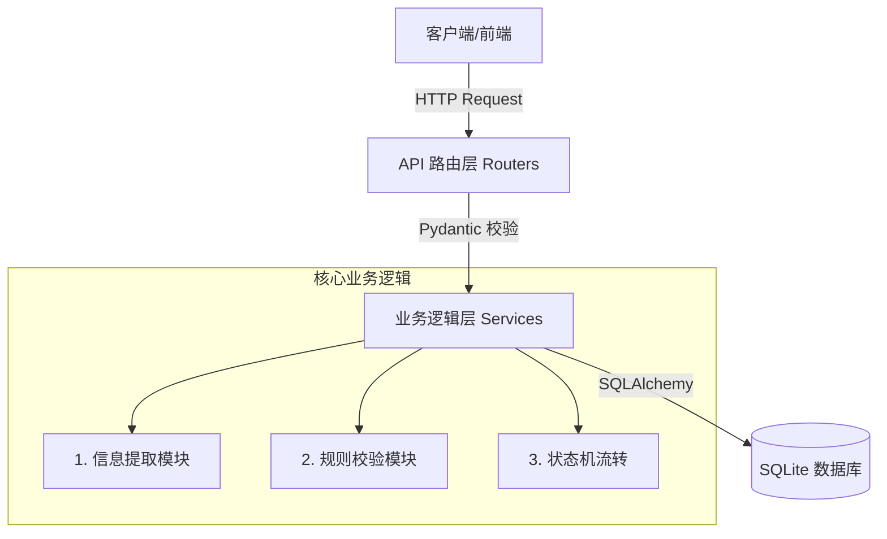
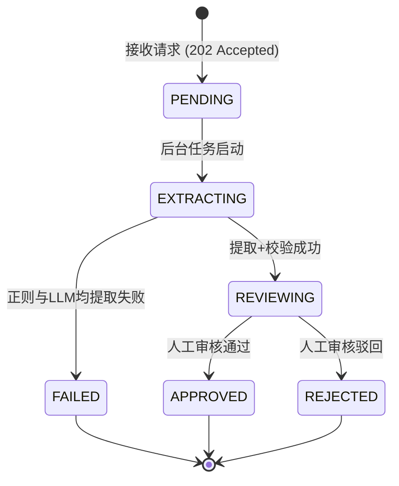

# 技术设计文档 (TDD) - Invoice-AI MVP

**文档版本**：v1.0.0
**对应 PRD**：v1.0.0
**主导角色**：架构师 (Architect)
**状态**：已评审通过

## 1. 技术栈选型 (Tech Stack)
考虑到本项目是 MVP（最小可行性产品），需在保证核心功能的前提下，尽可能降低运维和部署成本，选型如下：
- **语言**：Python 3.11（生态完善，AI 库多）。
- **Web 框架**：FastAPI（原生异步，自动生成 Swagger 接口文档，极大降低前端联调成本）。
- **数据库**：SQLite 3（免安装、单文件落盘。MVP 阶段首选，后续可通过 SQLAlchemy 平滑迁移至 PostgreSQL）。
- **ORM 框架**：SQLAlchemy 2.0（屏蔽底层 SQL 差异，提供企业级对象关系映射）。
- **配置管理**：`pydantic-settings` + `.env` 文件（确保敏感信息隔离，避免硬编码）。

## 2. 系统架构设计 (System Architecture)

### 2.1 分层架构图
采用经典的分层架构，各层单向依赖，严禁跨层调用（如 Router 直接调 DB）。

### 2.2 架构决策 (Why)
- **业务逻辑与路由分离**：将核心逻辑放在 Service 层，使得未来可以无缝从 HTTP 接口触发切换到定时任务（BackgroundTasks）触发，提高代码复用率。
- **引入异步非阻塞**：针对大模型调用和正则解析等耗时操作，采用 FastAPI 的 `BackgroundTasks` 异步处理，保证 HTTP 接口在 200ms 内返回响应。

## 3. 数据库设计 (Database Schema)

### 3.1 核心表：`invoices` (发票任务表)
结合安全 **4A 架构** 中的审计要求，补充了审核人与审核时间字段。

| 字段名 | 数据类型 | 约束/索引 | 说明 |
| :--- | :--- | :--- | :--- |
| `id` | Integer | PK, 自增 | 主键 |
| `raw_text` | Text | 必填 | 原始提交的发票文本 |
| `raw_text_hash` | String(32) | **UNIQUE**, Index | 原文的 MD5 哈希，用于接口幂等防抖 |
| `invoice_number`| String(50) | **UNIQUE**, Index | 发票号，唯一索引用于底层防止并发重复报销 |
| `amount` | Float | Nullable | 提取出的金额 |
| `invoice_date` | String(20) | Nullable | 提取出的发票日期 |
| `status` | String(20) | 必填, Index | 状态机（PENDING/EXTRACTING/REVIEWING/APPROVED/REJECTED/FAILED） |
| `is_duplicate` | Boolean | Default False | 风控标记：是否重复报销 |
| `is_large_amount`| Boolean | Default False | 风控标记：是否大额 (>10000) |
| `review_note` | Text | Nullable | 财务审核时的批注 |
| **`reviewer_name`** | **String(50)** | **Nullable** | **【审计】审核人姓名/ID** |
| **`reviewed_at`** | **DateTime** | **Nullable** | **【审计】审核完成时间** |
| `created_at` | DateTime | Default UTCNow | 任务创建时间 |
| `updated_at` | DateTime | OnUpdate UTCNow| 最后更新时间 |

### 3.2 架构决策与并发控制 (Why)
1. **幂等性保障 (Idempotency)**：如果前端网络卡顿连点两次提交，系统计算 `raw_text_hash`，若 5 秒内发现库中已有相同哈希且未失败，直接返回历史任务，避免浪费 AI 算力。
2. **防并发脏写 (Concurrency)**：AC 3.2 要求防止并发重复报销。架构上**绝不使用**“先 select 查询，再 insert 插入”的做法（因为并发时都会查不到然后同时插入）。强制在数据库层加 `UNIQUE` 唯一索引。应用层捕获 `IntegrityError` 后，转化为 `is_duplicate=True` 业务状态，保障数据绝对一致性。

## 4. API 接口契约 (API Contract)

| 方法 | 路径 | 功能描述 | 请求体 (Request) | 响应体 (Response) |
| :--- | :--- | :--- | :--- | :--- |
| POST | `/api/v1/invoices` | 提交发票文本 | `{"raw_text": "..."}` | `{"task_id": 1, "status": "PENDING"}` (202) |
| GET | `/api/v1/invoices/{id}`| 查询任务详情 | 无 | 包含提取和校验结果的完整对象 (200) |
| POST | `/api/v1/invoices/{id}/review` | 人工审核 | `{"action": "APPROVE", "note": "金额无误", "reviewer": "张三"}` | `{"status": "APPROVED"}` (200) |

## 5. 核心状态机设计 (State Machine)

状态流转必须严格遵守下图，杜绝非法跳转（如从 `PENDING` 直接跳到 `APPROVED`）。

## 6. 防幻觉与降级策略 (AI Fallback Design)

针对 PRD 中的 AC 2.2 和 5.1：
1. **降级策略**：先走便宜且极快的正则提取（Regex）。如果提取为空，再触发大模型兜底（Mock）。
2. **防幻觉机制**：大模型返回的 `amount` 或 `invoice_number`，系统必须反向验证其是否存在于 `raw_text` 字符串中。若不存在（说明模型在瞎编），直接丢弃该结果，任务转 `FAILED`。